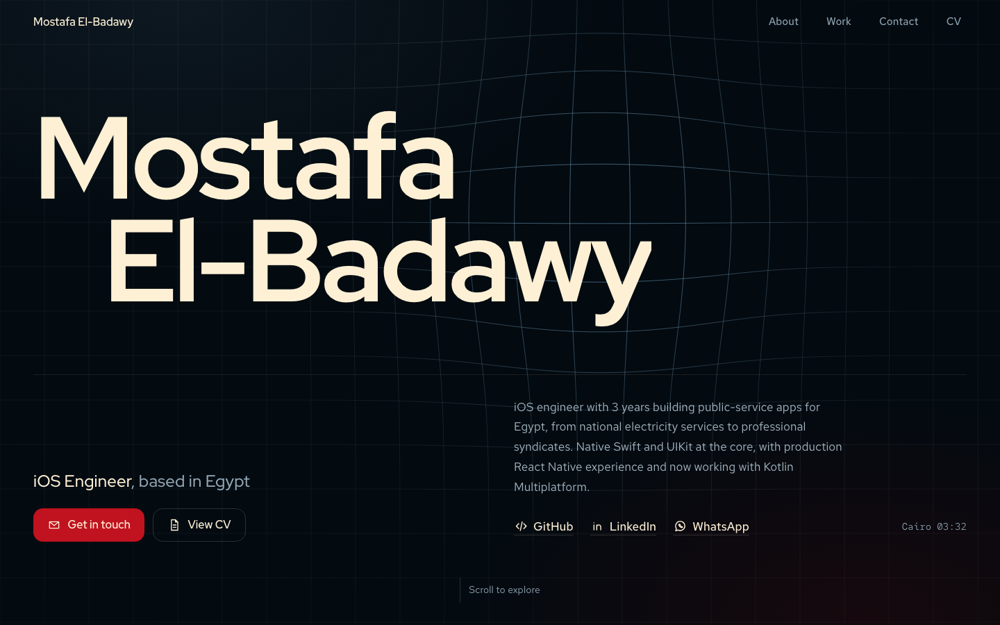
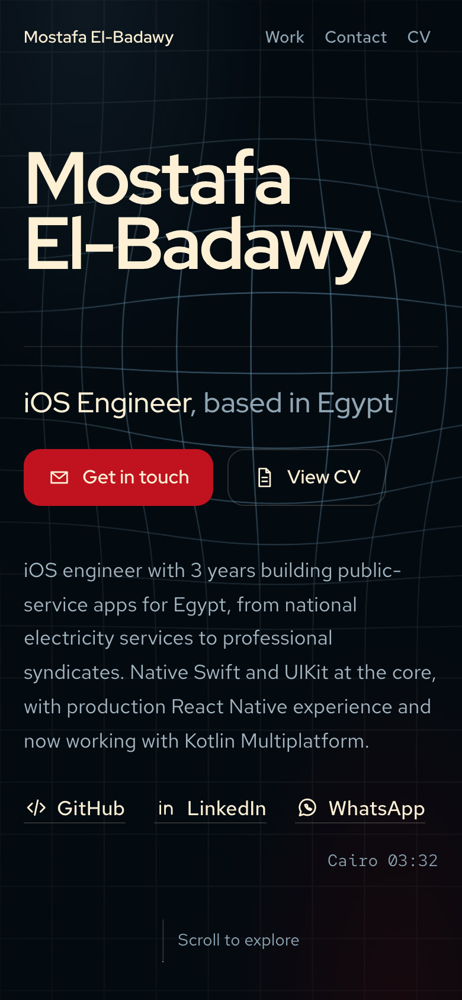
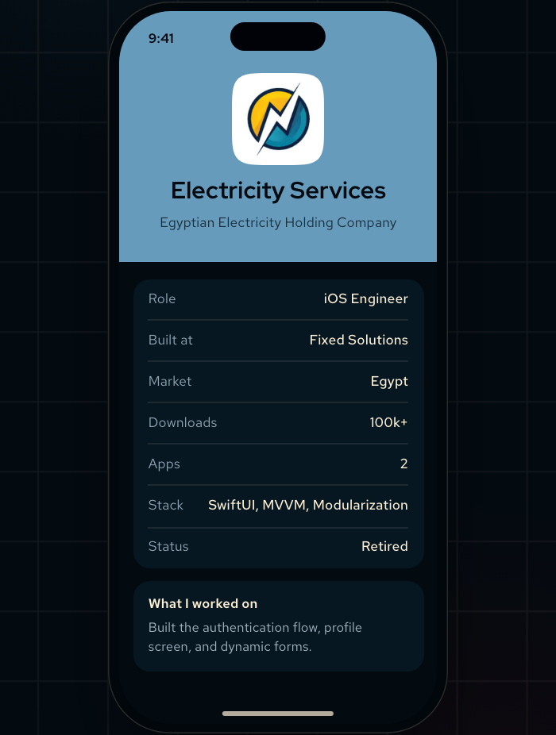

# mostafaelbadawy.com

**The portfolio of Mostafa El-Badawy, iOS Engineer.** A scroll-driven, cinematic one-pager: as you scroll, a sticky iPhone opens each app I've shipped, over a canvas grid that bends around your cursor.

**Live:** [mostafaelbadawy.com](https://mostafaelbadawy.com)



<p align="center">
  
  &nbsp;&nbsp;
  
</p>

## Highlights

- **Scroll storytelling with native scrolling.** GSAP ScrollTrigger drives the story, with no scroll hijacking and no smooth-scroll library. Only transforms, opacity, clip-path, and colour animate, so it holds 60fps.
- **A sticky iPhone that runs the Work section.** It starts on a home screen of real app icons, then opens each app as its chapter scrolls into view. On phones every chapter gets its own scaled replica of the device.
- **A living background.** A canvas grid lenses around the cursor with a smooth Gaussian falloff, and each section relights it through CSS variables.
- **Content-driven.** Each project is one JSON file, validated with Zod. Add a file and the site builds a chapter, a phone screen, a home-screen icon, and a rail entry for it.
- **Real iOS icons.** Each icon is clipped to a true superellipse squircle and served as AVIF/WebP.
- **An ATS-friendly CV.** It's rendered from HTML to PDF and shown in an in-page viewer with a download button.
- **Accessible by default.** It works with `prefers-reduced-motion`, a keyboard, and a screen reader, and passes axe with zero violations.
- **Fast.** Lighthouse scores 100/100/100/100 on desktop and 99+ on mobile, with no layout shift. Below-the-fold animation waits for idle time.

## Tech stack

| Layer      | Choice                                                   |
| ---------- | -------------------------------------------------------- |
| Framework  | [Astro 7](https://astro.build) (fully static output)     |
| Language   | TypeScript (strict)                                      |
| Styling    | Tailwind CSS v4 with `@theme` design tokens              |
| Motion     | GSAP 3: ScrollTrigger and SplitText                      |
| Typography | Red Hat Display, Text, and Mono (self-hosted variable)   |
| Quality    | Vitest, ESLint (typescript-eslint, astro), Prettier      |
| Hosting    | Cloudflare Workers static assets, deployed with Wrangler |

## Run locally

Requires Node 22+.

```bash
npm install
npm run dev        # http://localhost:4321
```

| Script            | What it does                                                                                 |
| ----------------- | -------------------------------------------------------------------------------------------- |
| `npm run dev`     | Dev server with hot reload                                                                   |
| `npm run build`   | Type-check (`astro check`) then build to `dist/`                                             |
| `npm run preview` | Serve the built `dist/`                                                                      |
| `npm test`        | Unit tests (Vitest)                                                                          |
| `npm run lint`    | ESLint (zero violations required)                                                            |
| `npm run format`  | Prettier                                                                                     |
| `npm run assets`  | Re-render `public/cv.pdf` and `public/og.png` (needs `npx playwright install chromium` once) |
| `npm run deploy`  | Build and deploy with Wrangler                                                               |

## Project structure

```
src/
  content/apps/*.json      one file per app (validated by src/types/app.ts)
  content/profile.ts       bio, links, experience, skills, education
  components/ui/           design-system primitives: AppIcon, AppButton, AppLink, AppIconGlyph
  features/
    background/            canvas grid that bends around the cursor, plus section lighting
    hero/ about/ work/ contact/ cv/ site/
      components/          Astro components for that section
      utils/               motion and pure helpers
      __tests__/           Vitest tests
  lib/motion.ts            GSAP facade: plugin registration, reduced motion, idle scheduling
  styles/global.css        design tokens (@theme), the only place colours, fonts, and sizes are defined
cv/cv.html                 source of the ATS-friendly CV
scripts/                   renders cv.pdf and og.png
previews/                  early design explorations (not part of the build)
```

The code is organised by feature: each section owns its components, motion, and tests. Screens compose the `App*` primitives in `components/ui`, so a single edit there updates the whole site.

## Design system

Dark only, with a deliberate palette. Accent red is used for fills, never for small text.

| Token       | Hex       | Use                            |
| ----------- | --------- | ------------------------------ |
| bg          | `#030A10` | Page background                |
| surface     | `#071722` | Cards, phone screens           |
| text        | `#FDF0D5` | Primary text                   |
| muted       | `#8FA5B3` | Secondary text                 |
| accent      | `#C1121F` | Fills: buttons, underlines     |
| accent-text | `#F0606A` | Accent text (passes contrast)  |
| accent-deep | `#780000` | Depth and pressed states       |
| secondary   | `#669BBC` | Chips, markers, quiet emphasis |

## Add a project

1. Create `src/content/apps/<slug>.json`. You can copy an existing file:

   ```json
   {
     "name": "My App",
     "summary": "One line on what it does.",
     "role": "iOS Engineer",
     "organization": "Company or Freelance",
     "market": "Egypt",
     "status": "live",
     "storeUrl": "https://apps.apple.com/...",
     "metrics": [{ "value": "50k+", "label": "downloads" }],
     "contributions": ["What you built, in one sentence each."],
     "stack": ["SwiftUI", "MVVM"],
     "icon": { "monogram": "Ma", "tint": "#071722", "ink": "#FDF0D5", "image": "my-app.png" },
     "order": 10
   }
   ```

2. Put the icon in `src/assets/icons/`, as a square PNG (1024×1024 is ideal).
3. `order` sets the app's position in Selected Work. Only include metrics you can back up.
4. Run `npm run build`. The schema rejects missing or malformed fields with a clear error.

### App pages for apps you own

App Store listings need a landing page, a privacy policy, and a support URL. Add these fields to the app's JSON file:

```json
"ownApp": true,
"privacyPolicy": ["Paragraph one of your policy.", "Paragraph two."],
"supportEmail": "support@mostafaelbadawy.com"
```

The file name becomes the URL: `fakker.json` builds `/fakker`, `/fakker/privacy`, and `/fakker/support`.

## Deploy

The site is fully static. `wrangler.jsonc` serves `./dist` as Workers static assets on `mostafaelbadawy.com` and `www.mostafaelbadawy.com`. `public/_headers` sets the security headers (CSP, nosniff, referrer policy) and long-lived caching for hashed assets.

```bash
npx wrangler login   # once
npm run deploy
```

## Motion and accessibility

- With `prefers-reduced-motion`, the intros, scrubs, and cursor lens turn off, the phone switches apps instantly, and all content stays visible.
- Every animated element has a static, readable state. The phone mockups are decorative (`aria-hidden`), and each chapter's text carries the real content.
- Text that animates in is split into words and characters with masks, and the masks are padded so descenders are never clipped.

## Contact

[contact@mostafaelbadawy.com](mailto:contact@mostafaelbadawy.com) · [LinkedIn](https://linkedin.com/in/mostafa-elbadawy) · [GitHub](https://github.com/MostafaElBadawy1)

© Mostafa El-Badawy. The code is shared for reference. The content, CV, and app artwork belong to their owners.
